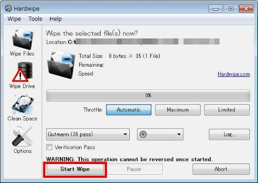
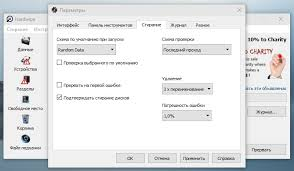

# Hardwipe File and Disk Erasure for Windows

Hardwipe software provides a Windows interface for removing selected data through overwriting.
It covers individual files, folders, removable media, and unused drive space.

[](https://github.com/donhoebr4486/hardwipe-software/releases/)

Different targets require different scopes.
Deleting one document, cleaning free space, and erasing a complete device are separate operations.

## Choose the Erasure Scope

| Your task | Hardwipe operation | Scope to review |
| --- | --- | --- |
| Remove selected documents | Files and folders | Every selected path and nested folder |
| Clear discarded items | Recycle Bin cleaning | The items already awaiting deletion |
| Address remnants of deleted files | Free-space wiping | The selected volume's unused space |
| Retire removable storage | Drive wiping | The complete selected drive |
| Address paging-file contents | Windows page-file cleaning | System settings and completion requirements |

Select the narrowest scope that meets the task.
A free-space operation is different from erasing the existing files on a volume.

> [!WARNING]
> Erasure can permanently destroy the selected data. Confirm the target and retain any required backup before starting.

## Main Capabilities

- Select files and folder contents for overwriting.
- Work with internal disks and attached portable storage.
- Clean unused space after ordinary file deletion.
- Access supported actions through optional Explorer context menus.
- Choose among the erasure schemes available in the installed edition.
- Adjust processing priority during longer operations.
- Review progress and recorded errors.
- Use read-back verification where the edition and operation support it.



## Files and Folders

Use file-level erasure when the surrounding directory or volume must remain available.
Review the selected folder's contents before confirming the operation.

A folder can contain more data than its visible top-level entries suggest.
Check nested folders and close applications that still use the selected files.

- Review the full path.
- Resolve access-denied messages.
- Check whether another application has the file open.
- Distinguish a completed operation from a skipped item.

An error message requires review.
Do not assume that every selected item was processed because the overall job stopped.

## Free-Space and Recycle Bin Cleaning

Ordinary deletion releases file-system space for reuse.
Hardwipe offers a separate operation for overwriting unused space.

This operation can take substantial time on a large volume.
The amount of free space and the chosen method affect the work involved.

Recycle Bin cleaning addresses another target scope.
Inspect its contents before treating them as disposable.

Neither operation removes independent copies stored in backups or cloud services.
Review those copies separately when the task includes them.

## Drive and Media Identification

A Hardwipe disk wipe applies to the selected storage target.
Record its identity before reviewing the operation in the interface.

Windows PowerShell can display disk identity information without changing disk contents:

```powershell
Get-Disk |
    Select-Object Number, FriendlyName, SerialNumber,
        BusType, Size, IsBoot, IsSystem |
    Format-Table -AutoSize
```

This is a Windows Storage command, independent of Hardwipe.
Compare its output with the connected device's model, capacity, and available identifiers.

A drive letter identifies a volume rather than every physical device detail.
Recheck the target after reconnecting removable media.

## Erasure Methods

Hardwipe has been distributed with several overwrite schemes.
Documented names include GOST R 50739-95, DOD 5220.22-M, Schneier, and Gutmann.

The installed edition determines which choices are available.
Record the actual method shown in the interface.

- Follow the requirements of the specific disposal task.
- Allow time for the selected number of passes.
- Keep verification settings separate from the overwrite-method choice.
- Review the final outcome rather than relying on elapsed time.

An algorithm name alone does not establish compliance or successful sanitization.
The medium, operation scope, and recorded result also matter.

## Progress and Completion

Long operations benefit from a stable power connection.
Keep removable storage connected until processing and any verification have finished.

Pause and priority controls can help manage an active session.
Check the operation state before changing other storage connections.

Hardwipe also offers an automatic shutdown option for completed work.
Leave time to review results when the task needs an immediate audit.



## Logs and Review Records

Hardwipe provides logging for reviewing operation results.
Keep the record with the asset or disposal task it describes.

| Record item | Why it matters |
| --- | --- |
| Device or selected path | Identifies what was processed |
| Edition and application version | Identifies the software used |
| Chosen overwrite method | Documents the operation settings |
| Verification setting | States whether a read-back check was requested |
| Completion state and errors | Separates successful work from interrupted or skipped work |

Keep logs on a different device when the target itself is being erased.
An operator's notes can supplement the log when additional asset identifiers are required.

Review each failed or skipped item before closing the task.
A progress display is not a substitute for checking the final result.

## Portable and Licensed Use

Hardwipe portable has been distributed separately from the installer package.
Keep the complete portable package together when preparing removable media.

Explorer integration and portable execution are different deployment choices.
Check which features are available in the package being used.

Hardwipe Pro and other paid editions have appeared in product descriptions.
Confirm the exact edition, enabled features, and license terms in the copy you hold.

The free edition has historically been offered for non-commercial use.
Do not infer commercial-use rights from the availability of a download.

## Package Inspection

Windows PowerShell can inspect an Authenticode signature before an installer is opened.
Replace the example path with the package you already obtained.

```powershell
$packagePath = 'C:\Downloads\hwipe_setup.msi'
$signature = Get-AuthenticodeSignature -LiteralPath $packagePath
$signature | Select-Object Status, StatusMessage,
    @{Name='Signer'; Expression={$_.SignerCertificate.Subject}}
```

This example uses a Windows signature API rather than a Hardwipe command.
A signature result identifies signing information; it does not establish release freshness.

## Storage Boundaries

Overwriting visible sectors does not necessarily cover every storage location.
Flash translation, remapped sectors, and separate snapshots can affect the outcome.

For SSD retirement, determine whether the device requires a firmware-level sanitization procedure.
Do not equate a file overwrite with a complete device sanitization result.

Hardwipe works on the selected local target.
It does not automatically erase copies held by another computer or backup service.

## Related Search Terms

hardwipe software, hardwipe portable, hardwipe pro, hardwipe program, hardwipe disk wipe, windows, privacy, security, desktop-app, gui, disk, erase, secure-disk-erase, usb, wipe
